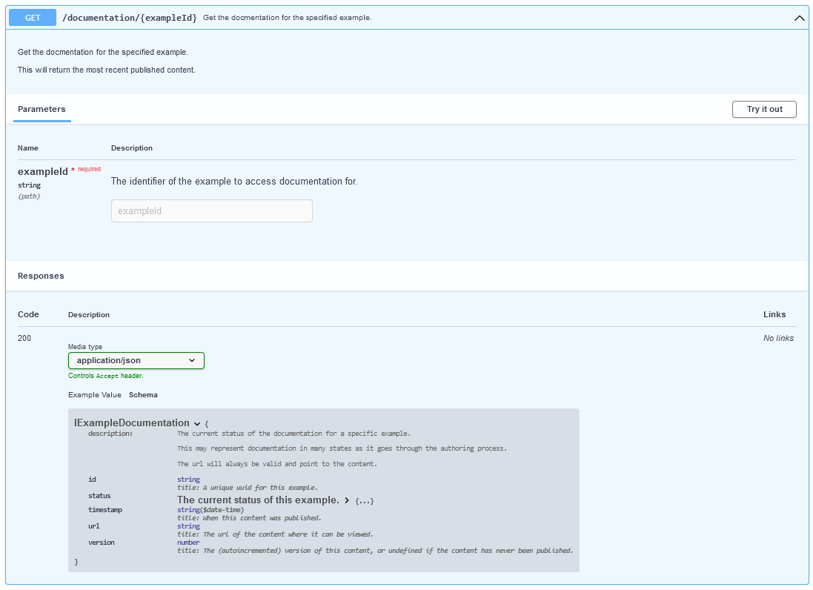

# ts-openapi-gen

A generator for [OpenAPI documentation](https://www.openapis.org/) based on TypeScript, Express, Inversify and TypeDoc.

Created by [Nicholas Elliott](https://nicholasmtelliott.com) at Skyward App Company. Maintained by [@NicholasMTElliott](https://github.com/NicholasMTElliott).

> **Maintenance mode (2026).** This project is no longer developed and the repository is archived. Version 1.4.0 on npm still works for the setup it was built for: TypeScript 4.0–4.7, TypeDoc 0.22, and `inversify-express-utils` controllers. It cannot support TypeScript 5 or later, because TypeDoc 0.23 removed the decorator data it depends on. The reasoning is in [docs/adr/0001-maintenance-mode.md](docs/adr/0001-maintenance-mode.md).
>
> For new projects, see [Alternatives](#alternatives).

## Overview

Code an API using [Express](http://expressjs.com/) and [InversifyJS](https://inversify.io/). Comment it using [JSDoc](https://jsdoc.app/about-getting-started.html)...


... and type it using [TypeScript](https://www.typescriptlang.org/) 4.0–4.7.


Install TypeDoc and ts-openapi-gen:

```sh
yarn add --dev typedoc@~0.22 typedoc-plugin-expand-object-like-types@^0.1 typedoc-plugin-missing-exports@~0.22 @skywardapps/ts-openapi-gen
```

Generate the TypeDoc JSON for your controllers, then the OpenAPI document from it:

```sh
yarn run typedoc --json ./docs/typedoc.json --entryPointStrategy Expand --disableSources --plugin typedoc-plugin-expand-object-like-types --plugin typedoc-plugin-missing-exports --pretty src/controllers
yarn run ts-openapi-gen --typedoc ./docs/typedoc.json --out assets/public/openapi.json
```



## Getting started

This assumes a REST API written in TypeScript, commented with JSDoc, with endpoints built on `inversify-express-utils` on top of Express.

### Requirements

- InversifyJS and `inversify-express-utils`
- TypeScript 4.0–4.7
- TypeDoc 0.22
- Express

Your project must build (dependencies installed, code compiles) before TypeDoc can read it.

### Command-line options

| Option | Description | Default |
| --- | --- | --- |
| `--typedoc` | The TypeDoc JSON file to read. | `./typedoc.json` |
| `--out` | The file to write the OpenAPI document to. | `./openapi.json` |
| `--description` | A Markdown file used as the API description. Lines starting with `@` set document properties (see below) and are removed from the description. | none |

### Description file directives

In the `--description` file, a line of the form `@key: value` sets a property on the document. Keys are case-insensitive. Every line that starts with `@` must have a `: value` part, or generation fails.

| Directive | Sets |
| --- | --- |
| `@title` | `info.title` |
| `@version` | `info.version` |
| `@name` | `info.contact.name` |
| `@email` | `info.contact.email` |
| `@url` | `info.contact.url` |
| `@licence.name` | `info.license.name` (note the spelling) |
| `@license.url` | `info.license.url` |
| `@termsOfService` | `info.termsOfService` |

Two experimental directives add an OAuth2 password-flow security scheme named `<scheme>`:

| Directive | Sets |
| --- | --- |
| `@oauth2.<scheme>.password.tokenUrl` | the flow's token URL |
| `@oauth2.<scheme>.password.scopes.<scope>` | a scope and its description, required by the document's security requirement |

## Features

- Discovers published endpoints from controller decorators and derives the HTTP method and path.
- Reads JSDoc comments for summaries, descriptions, parameters and return values.
- Reflects TypeScript types into schemas for request bodies and responses.
- Unwraps Inversify wrapper types (`Promise`, `OkNegotiatedContent`, etc.).

See the [sample project](samples/getting_started) for an API that documents itself this way.

## Alternatives

When this tool was written, there was no simple way to get an OpenAPI document from plain TypeScript types without annotating every route. That has changed. Most current frameworks either read your types at build time or build the document from the same schema that validates requests.

| If you use | Consider |
| --- | --- |
| NestJS | [`@nestjs/swagger`](https://docs.nestjs.com/openapi/introduction) with its [CLI plugin](https://docs.nestjs.com/openapi/cli-plugin), which reads types and comments, or [Nestia](https://nestia.io/), which analyzes types at compile time |
| Fastify | [`@fastify/swagger`](https://github.com/fastify/fastify-swagger), built from route schemas |
| Hono | [`hono-openapi`](https://github.com/rhinobase/hono-openapi) (any Standard Schema validator) or [`@hono/zod-openapi`](https://github.com/honojs/middleware/tree/main/packages/zod-openapi) |
| Express | [tsoa](https://github.com/lukeautry/tsoa) (decorated controllers, types-driven) or [`@asteasolutions/zod-to-openapi`](https://github.com/asteasolutions/zod-to-openapi) |
| Any framework, contract-first | [oRPC](https://orpc.dev/) or [ts-rest](https://ts-rest.com/) |

## Issues and pull requests

The repository is archived, so it no longer accepts issues or pull requests. Fork it if you need changes; the MIT license allows that.

## Authors


[Nicholas Elliott](https://nicholasmtelliott.com) at Skyward App Company, LLC
